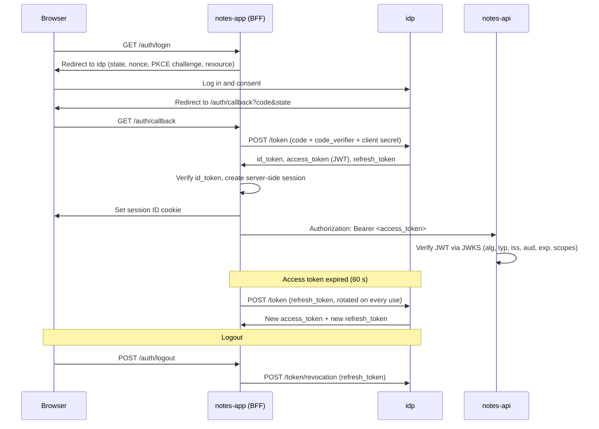

# oidc-lab

A hand-built OAuth 2.0 / OpenID Connect system: an identity provider, a client app, and a resource API, each implemented from scratch to see how token-based authentication works end to end.

> **This is a learning project, not a product.** When there's a choice between a shortcut and seeing the mechanism, it picks the mechanism.

## Why

Session-cookie auth libraries (like Better Auth) work well, but they hide the model most other systems use: access and refresh tokens, JWT verification against a JWKS, PKCE, and refresh token rotation. Building every party in the flow makes each step, and each security check, visible.

The OAuth client is written by hand on purpose. No `openid-client`, Auth.js, or Passport; [`jose`](https://github.com/panva/jose) is the only helper (JWT signing and verification, JWKS).

## Architecture

pnpm monorepo, TypeScript throughout.

| App                                | Stack                                                                    | URL                         | Role                                                                    |
| ---------------------------------- | ------------------------------------------------------------------------ | --------------------------- | ----------------------------------------------------------------------- |
| [`idp/`](idp/README.md)             | Express + [`oidc-provider`](https://github.com/panva/node-oidc-provider) | `http://idp.localhost:4000` | Identity provider: logs users in, issues tokens, serves the JWKS        |
| [`notes-app/`](notes-app/README.md) | Next.js                                                                  | `http://app.localhost:3000` | Client app (UI + BFF): runs the OAuth flow, holds the tokens server-side |
| [`notes-api/`](notes-api/README.md) | NestJS                                                                   | `http://api.localhost:5000` | Resource server: notes CRUD, verifies JWT access tokens locally         |

The browser only ever holds a session ID cookie for `notes-app`. It never sees a token: `notes-app` is a **backend-for-frontend** (a confidential client with a client secret), and every call to `notes-api` comes from its server.

Each app has its own hostname because cookies are scoped by host, not port. With everything on `localhost`, the apps would share one cookie jar and hide cross-site behaviour.

## The flow



## Tokens

| Token          | Issued to   | Format                     | Lifetime | Checked by                                                          |
| -------------- | ----------- | -------------------------- | -------- | ------------------------------------------------------------------- |
| `id_token`     | `notes-app` | JWT                        | 1 hour   | `notes-app`, once at sign-in: signature, `iss`, `aud`, `exp`, `nonce` |
| Access token   | `notes-api` | JWT (`typ: at+jwt`)        | 60 s     | `notes-api`, on every request: signature, `iss`, `aud`, `exp`, scopes |
| Refresh token  | `notes-app` | Opaque                     | 14 days  | The IdP, on every refresh                                           |

The access token lifetime is short on purpose, so expiry and refresh are easy to watch.

## What each part demonstrates

**Sign-in (`notes-app`)**

- Authorization code flow with **PKCE** (`S256`), **`state`** (login CSRF), and **`nonce`** (`id_token` replay).
- `state`, `nonce`, and the PKCE verifier live in a single-use, server-side login transaction. The browser only holds its random ID in a short-lived cookie.
- Code exchange with `client_secret_basic`, then `id_token` verification with `jose`: JWKS, pinned `RS256`, `iss`, `aud`, `exp`, `nonce`.
- Server-side sessions: the cookie holds a random ID; tokens stay on the server.

**Access tokens (`idp` + `notes-api`)**

- **Resource indicators** (RFC 8707): `resource=http://api.localhost:5000` makes the IdP issue a JWT access token addressed to `notes-api`, instead of an opaque token only the IdP can read.
- `notes-api` verifies tokens locally (no call to the IdP per request) in one global NestJS guard. Routes declare `@Public()` or `@RequireScopes(...)`; a route with neither fails closed.
- RFC 6750 errors: `401 invalid_token`, `403 insufficient_scope`. Ownership comes from the token's `sub`; someone else's note is a `404`.

**Refresh tokens (`idp` + `notes-app`)**

- `offline_access` scope (which `oidc-provider` only grants with `prompt=consent`).
- **Rotation**: every refresh returns a new refresh token. **Reuse detection**: presenting a used one revokes the whole grant.
- **Single-flight**: at most one refresh per session runs at a time, so parallel requests can't trigger reuse detection against their own app.
- A `401` from `notes-api` triggers one forced refresh and one retry. A rejected refresh token ends the session; an IdP outage doesn't.
- Logout revokes the refresh token at the IdP (RFC 7009).

## Getting started

**Prerequisites:** Node 24+ and pnpm via Corepack (`corepack enable`).

**Hostnames:** add this to your hosts file (on WSL2, the Windows one):

```
127.0.0.1 idp.localhost app.localhost api.localhost
```

**Configure:**

```bash
pnpm install
cp idp/.env.example idp/.env                    # NOTES_APP_CLIENT_SECRET, COOKIE_KEYS
cp notes-app/.env.example notes-app/.env.local  # OIDC_CLIENT_SECRET must equal NOTES_APP_CLIENT_SECRET
```

See [`idp/README.md`](idp/README.md) and [`notes-app/README.md`](notes-app/README.md) for each variable.

**Run** (one terminal each):

```bash
pnpm --filter idp dev              # http://idp.localhost:4000
pnpm --filter notes-api start:dev  # http://api.localhost:5000
pnpm --filter notes-app dev        # http://app.localhost:3000
```

Open `http://app.localhost:3000` and sign in. The IdP uses `oidc-provider`'s built-in development login screens, which accept any username and password. Create a note, wait a minute, and create another: the `notes-app` log shows one silent refresh.

Checks:

```bash
pnpm --filter idp typecheck   # tsx doesn't type-check, tsc does
pnpm --filter notes-api test  # Vitest
```

## Limitations

These are deliberate for a local learning setup; each would have to change before real use.

- **Everything is in memory.** The IdP's codes, grants, and refresh tokens, and `notes-app`'s sessions and login transactions, are lost on restart, which signs everyone out.
- **Development signing key.** The IdP signs tokens with `oidc-provider`'s built-in key, whose private half is public. Never trust tokens from this setup outside local development.
- **Development login screens.** No real users or passwords.
- **One `notes-app` process.** Single-flight refresh uses an in-process `Map`; several instances would need a shared lock.
- **Plain HTTP.** Cookies aren't `secure`.
- **Local logout only.** Logging out of `notes-app` revokes its tokens but doesn't end the session at the IdP, so the next sign-in skips the password prompt.

## Status

All four phases are complete:

- [x] **1. Bare IdP:** in-memory provider, one static client, a full flow driven by hand with `curl`
- [x] **2. Client auth by hand:** login, callback, logout, server-side sessions, `id_token` verification
- [x] **3. Resource API:** JWT access tokens, NestJS guard with JWKS, `aud`/`iss`/scope checks
- [x] **4. Refresh tokens:** rotation, reuse detection, single-flight refresh per session, revocation on logout

The step-by-step tasks for each phase are in `TASKS-phase1.md` to `TASKS-phase4.md`.
